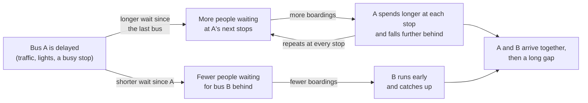
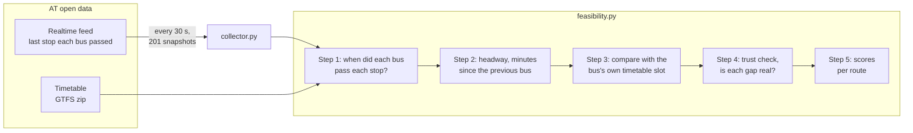
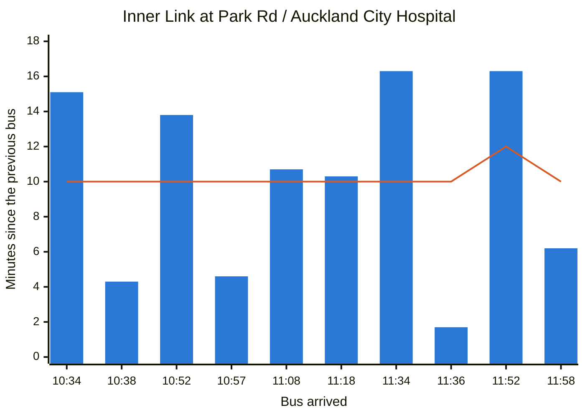
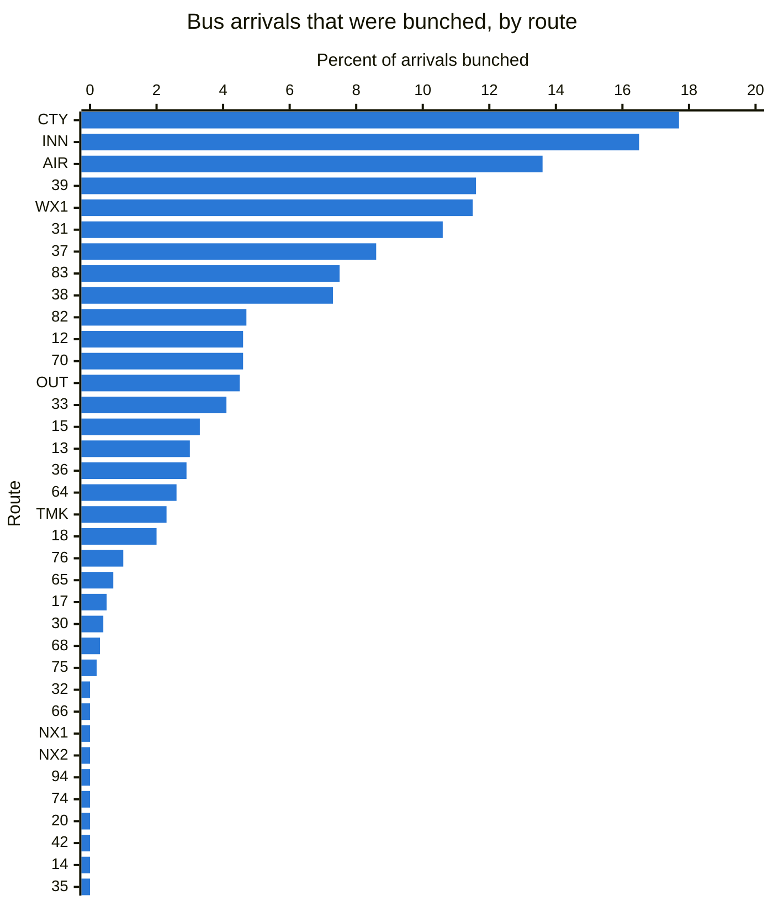
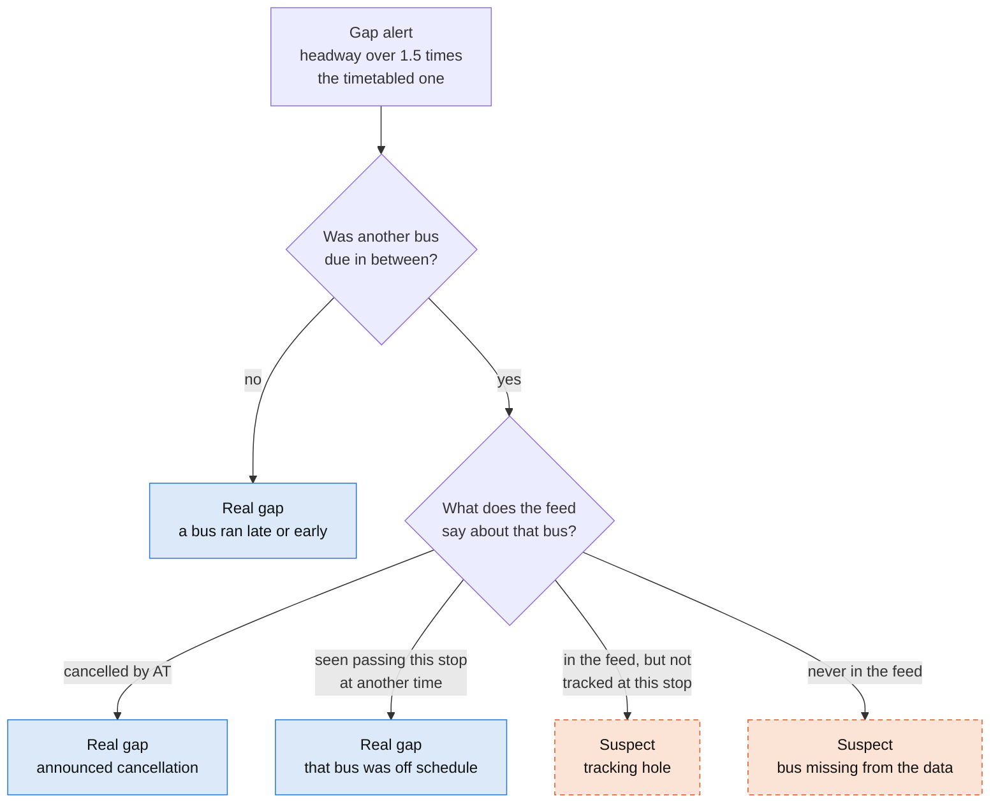
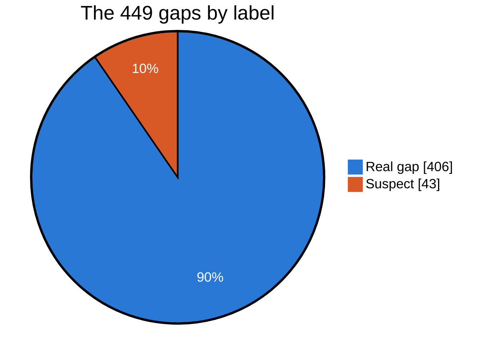
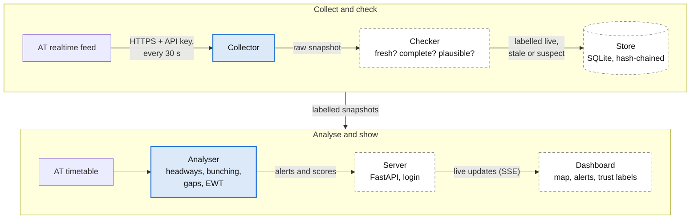
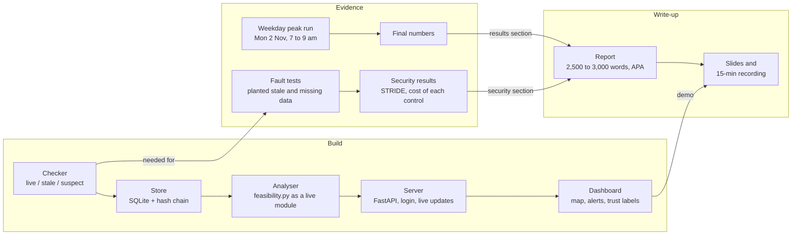

# AT Gap Monitor: feasibility test

MSE806 Intelligent Transportation Systems, Assessment 2
Test run on Saturday 31 October 2026, 10:19 to 12:00. Prepared 31 October 2026.

> The diagrams are written in Mermaid. They display on GitHub, in Obsidian, and in VS Code with a Mermaid preview extension.

## Summary

Before committing to this project we wanted to answer two questions:

1. Do Auckland buses bunch often enough for a bunching monitor to be useful?
2. Is Auckland Transport's (AT) live data good enough to build one on?

We recorded AT's live feed every 30 seconds for 1 hour 40 minutes and compared it with the timetable. The answer to both questions is yes.

- Bunching is common. In 100 minutes there were 56 cases of two buses running together for three or more stops, on 22 of the 36 frequent routes.
- It is concentrated. Six routes produced half of all the bunching with only a sixth of the bus arrivals. On City Link and Inner Link, both city-centre routes, about 1 in 6 buses arrived bunched with the bus in front.
- The data is good. 201 of 203 calls worked, the data was under a second old, and 99.8% of timetabled trips appeared in the feed.
- The data is not perfect, and that supports our design. About 1 in 10 gap alerts came from tracking holes, not missing buses. Our trust check caught them. Without it, City Link would have ranked as the worst route in Auckland; with it, City Link is fifth.

**Recommendation:** go ahead. Demo on Inner Link (INN), use City Link (CTY) to show the trust check, compare both with the Northern Express (NX1) on the busway, and run the collector once more during a weekday morning peak.

## 1. The problem

A headway is the time between two buses of the same route at the same stop. If buses run to time, headways match the timetable. Bunching breaks that pattern: a small delay grows on its own until two buses travel together and leave a long gap behind them.



*Figure 1. Why bunching gets worse by itself. A late bus has more people to pick up, so it gets later. The bus behind has fewer, so it catches up.*

For passengers that means a long wait and then two buses at once. For AT it means a crowded bus running just ahead of an empty one. If a controller sees bunching starting, they can hold the bus behind for a minute or two, or let the late bus skip some stops. Our monitor is meant to spot it early enough for that.

What we measure:

| Term | Meaning | Rule we used |
|---|---|---|
| Bunched | A bus arrives much too soon after the one in front | Headway under half the timetabled headway (under 5 min on a 10-min route) |
| Gap | A bus arrives much too late after the one in front | Headway over 1.5 times the timetabled headway (over 15 min on a 10-min route) |
| Episode | The same two buses keep being flagged | Flagged at 3 or more stops |
| Excess wait time (EWT) | Extra minutes the average passenger waits because buses are unevenly spaced | Actual average wait minus the wait the timetable promises. London uses this measure for its frequent bus routes |

For one stop, with actual headways *h* and timetabled headways *s*:

$$\text{EWT} = \frac{\sum h^2}{2 \sum h} - \frac{\sum s^2}{2 \sum s}$$

The first part is the average wait of a passenger who turns up at a random time. The second part is the same thing for the timetable.

## 2. How we tested it



*Figure 2. The test. The collector saved AT's live feed every 30 seconds; feasibility.py matched it to the timetable and scored each route.*

- When: Saturday 31 October 2026, 10:19 to 12:00.
- Where: every stop that a route serves at least every 15 minutes, which is AT's standard for a frequent service. That came to 2,103 stops on 36 routes.
- Bus times: AT reports the last stop each bus passed. Checking every 30 seconds caught 94% of stop passes directly. The other 6% were filled in between known stops.
- Fair comparison: each bus is compared with its own timetable slot, because some timetables are uneven (route 39 runs 15, 19, 15, 15 minutes apart). We also skip the last stop of every trip. Nobody boards there, and on loop routes like Inner Link it is also the first stop, which would make buses look bunched.

## 3. Is the data good enough?

| Check | Result |
|---|---|
| API calls that worked | 201 of 203 |
| Age of the data when it arrived | 0.7 s (median) |
| API response time | 1.6 s (median) |
| Longest time without fresh data | 73 s |
| Trips in the feed found in the timetable | 2,640 of 2,640 (100%) |
| Timetabled bus trips that showed up in the feed | 1,325 of 1,327 (99.8%) |
| Trips AT marked as cancelled | 2 |
| Stop passes reported directly by AT | 94% of 35,813 (the rest filled in) |
| Disk space | 33 MB for the whole test, about 20 MB an hour |

Two calls failed: a timeout at 11:34 and a failed network lookup at 11:56. Both times the collector tried again 10 seconds later and carried on, so we were never more than 73 seconds without fresh data. That is useful evidence for the availability part of our security assessment.

Calling every 30 seconds around the clock comes to 20,160 calls a week. Our planning notes put AT's limit at 35,000 a week, which we should confirm on the developer portal.

## 4. Do Auckland buses bunch?

We measured 12,994 headways. After setting aside 43 gaps the data could not confirm (section 5):

- 4.4% of bus arrivals were bunched and 3.1% came after a gap.
- There were 56 bunching episodes and 48 gap episodes in 100 minutes.
- 22 of the 36 routes had at least one bunching episode.

### Example: Inner Link at Auckland City Hospital



*Figure 3. Bars: minutes since the previous Inner Link bus (anticlockwise) at the Park Road / Auckland City Hospital stop. Line: what the timetable planned.*

The timetable planned a bus every 10 minutes (12 minutes once). Passengers got gaps of 15, 4, 14, 5, 11, 10, 16, 2, 16 and 6 minutes. Someone who reached the stop at 11:19 waited 15 minutes, and then two buses came 2 minutes apart. AT reported all ten of these times directly; none were filled in.

<details>
<summary>Numbers behind Figure 3</summary>

| Bus arrived | 10:34 | 10:38 | 10:52 | 10:57 | 11:08 | 11:18 | 11:34 | 11:36 | 11:52 | 11:58 |
|---|--:|--:|--:|--:|--:|--:|--:|--:|--:|--:|
| Minutes since previous bus | 15.1 | 4.3 | 13.8 | 4.6 | 10.7 | 10.3 | 16.3 | 1.7 | 16.3 | 6.2 |
| Timetable (minutes) | 10 | 10 | 10 | 10 | 10 | 10 | 10 | 10 | 12 | 10 |
| Flag | gap | bunched | | bunched | | | gap | bunched | | |

</details>

### Example: two buses together for an hour on route 39

On route 39 (Otara to Manurewa), one bus was running about 18 minutes late. The bus timetabled 15 minutes behind it was only about 5 minutes late, so it caught up. The two then ran together for 52 stops, from 10:34 to 11:31, about 1.5 minutes apart. The next bus came 22 to 26 minutes after them, where the timetable planned 19.

### Bus loads fit the theory

AT's feed also says how full each bus is. We had the load of both buses in 53 bunching episodes. Most of the time both had plenty of seats, as you would expect on a Saturday morning. When the loads differed, the front bus was the fuller one in 16 of 21 cases, which is the pattern Figure 1 predicts.

### Which routes bunch



*Figure 4. Share of bus arrivals that were bunched, for all 36 frequent routes. Appendix A has the numbers.*

Six routes are above 10%: City Link (CTY), Inner Link (INN), Airport Link (AIR), 39, WX1 and 31. Together they produced 51% of all the bunching while carrying 16.5% of the bus arrivals. Ten routes had no bunching at all, among them both Northern Express routes (NX1 and NX2). These use the Northern Busway, a road only buses can use, for much of their trip, which is likely why they keep their spacing.

| Route | Where | Bus every | Bunched | Gaps | Extra wait | Bunching episodes |
|---|---|--:|--:|--:|--:|--:|
| 39 | Otara to Manurewa | 15 min | 11.6% | 5.6% | 1.48 min | 4 |
| 38 | Airport to Onehunga | 15 min | 7.3% | 8.5% | 1.17 min | 1 |
| AIR | Airport to Puhinui Station | 10 min | 13.6% | 15.1% | 1.01 min | 3 |
| 31 | Mangere to Botany | 15 min | 10.6% | 5.8% | 0.98 min | 3 |
| CTY | City Link, Wynyard Quarter to K Rd (city centre) | 8 min | 17.7% | 12.5% | 0.95 min | 4 |
| INN | Inner Link loop (city centre) | 10 min | 16.5% | 8.2% | 0.81 min | 13 |
| WX1 | Northwest to City Centre by motorway | 10 min | 11.5% | 6.4% | 0.65 min | 3 |
| 70 | Botany to Britomart | 10 min | 4.6% | 5.1% | 0.42 min | 3 |
| NX1 | Albany to Britomart (Northern Busway) | 10 min | 0.0% | 4.7% | 0.18 min | 0 |
| NX2 | Albany to the universities (Northern Busway) | 15 min | 0.0% | 0.0% | 0.18 min | 0 |

Extra wait is highest on routes 39, 38 and the Airport Link, all in south Auckland. On Inner Link, 0.81 minutes of extra wait is 16% on top of the 5-minute average wait that a bus every 10 minutes promises.

## 5. The trust check: is each alert real?

A gap alert only helps if the gap is real. When a bus comes much later than planned, the monitor checks whether another bus was due in between, and if so, what the feed says about that bus.



*Figure 5. How each gap is labelled. Suspect gaps (orange, dashed) are kept out of all the scores.*



*Figure 6. The 449 gaps by label. The 43 suspect gaps were 36 buses not tracked at that stop and 7 buses missing from the feed. No gaps came from cancellations.*

43 of the 449 gaps (9.6%, about 1 in 10) were suspect. Most were tracking holes: the bus was in the feed, but AT's tracking of it started late or ended early, so we never saw it pass that stop. None of the gaps came from cancellations, as AT cancelled only 2 trips during the test.

Counting suspect gaps as real would change the ranking:

| Route | Extra wait, suspect gaps counted | Extra wait, suspect gaps set aside | Rank out of 36 |
|---|--:|--:|:-:|
| CTY City Link | 1.62 min | 0.95 min | 1st → 5th |
| 33 | 0.60 min | 0.41 min | 9th → 14th |
| 15 | 0.38 min | 0.18 min | 18th → 29th |

A monitor that trusts the feed blindly would point AT's controllers at the wrong route. Labelling data as live, stale or suspect is the core of our design, and this test gives it a measured result for the report.

## 6. Is Auckland big enough?

One worry was that Auckland is too small to have enough busy routes. The timetable says otherwise:

| Bus routes in AT's timetable | Saturday 31 Oct | Weekday (Tue 3 Nov) |
|---|--:|--:|
| Running that day | 162 | 189 |
| Every 15 min or better (7 am to 7 pm average) | 34 | 38 |
| ... of those, reaching the city centre | 14 | 17 |
| Every 10 min or better | 7 | 10 |

Bunching doesn't depend on the size of the city. It needs buses that come often and get held up by traffic and busy stops, and Auckland has 38 routes running every 15 minutes or better on weekdays.

## 7. What this test doesn't show yet

- It covers one short window on a Saturday, with light traffic. Weekday peaks are probably worse; one run on a weekday morning would confirm it.
- AT cancelled only 2 trips, so the "cancelled trip" label hasn't really been tested.
- 6% of stop times were filled in between known stops rather than measured.
- When we set a suspect gap aside, we lose one long headway but don't add back the two real ones it hides. That makes the score for those routes a little too low (route 68 even goes slightly below zero). The live system should estimate when the untracked bus passed instead.
- Excess wait assumes passengers turn up at random. That holds for buses every 15 minutes or better, but not for less frequent routes, where people time their trips.
- The thresholds (half and 1.5 times the timetable) are our choice. The report should back them with a source.
- Saturday buses were mostly empty, so the bus-load result rests on only 21 episodes.

## 8. What we would build



*Figure 7. The planned system. Solid blue: built and used in this test (the analyser as a prototype, feasibility.py). Dashed: still to build.*

Focus routes:

- Inner Link (INN) for the demo. It had the most bunching episodes (13 in 100 minutes, about one every 8 minutes) and no suspect gaps, so a live demo will very likely show an alert. It runs every 10 minutes on Saturdays and weekdays.
- City Link (CTY) to show the trust check. It had the highest share of bunching (17.7%) and 5 suspect gaps that would have made it look worse than it was.
- Northern Express (NX1) as the comparison: frequent, on the busway, almost no bunching.

Privacy and security from the start:

- The API key lives in a `.env` file that git ignores.
- Licence plates are removed before anything is saved.
- We report on routes and stops, never on individual drivers or vehicles (Privacy Act 2020).
- The store will keep a hash-chained log, so changed or deleted snapshots can be detected. The security section will use STRIDE and measure what each control costs.

## 9. Next steps



*Figure 8. What depends on what. The three tracks can run in parallel; labelled arrows are where one track needs another.*

Decisions for the group:

1. Do we go ahead with this project? The test says yes.
2. Focus routes: INN for the demo, CTY for the trust check, NX1 as the comparison.
3. Who runs the collector on Monday 2 November, 7 to 9 am? It needs a laptop that stays awake and an AT API key, which is free from AT's developer portal.
4. Who takes each track, and what is our exact due date?

## Appendix A. Results for all 36 routes

Sorted by extra wait. "Bus every" is the typical timetabled headway during the test. Suspect gaps are left out of every other column. A negative extra wait means buses were more evenly spaced than the timetable itself.

| Route | Description (one direction) | City centre | Bus every | Headways | Bunched | Gaps | Extra wait | Episodes (bunched / gap) | Suspect gaps |
|---|---|:-:|--:|--:|--:|--:|--:|:-:|--:|
| 39 | Otara / MIT to Manurewa Interchange via Mahia Rd |  | 15 min | 553 | 11.6% | 5.6% | 1.48 min | 4 / 1 | 0 |
| 38 | Airport to Onehunga via Mangere Town Centre |  | 15 min | 260 | 7.3% | 8.5% | 1.17 min | 1 / 2 | 2 |
| AIR | Airport Link via Puhinui Station |  | 10 min | 199 | 13.6% | 15.1% | 1.01 min | 3 / 3 | 1 |
| 31 | Mangere Town Centre to Botany Town Centre Via Otara |  | 15 min | 417 | 10.6% | 5.8% | 0.98 min | 3 / 2 | 0 |
| CTY | Wynyard Quarter to Karangahape Rd via Queen St | yes | 8 min | 192 | 17.7% | 12.5% | 0.95 min | 4 / 5 | 5 |
| INN | Inner Link loop, clockwise and anticlockwise | yes | 10 min | 623 | 16.5% | 8.2% | 0.81 min | 13 / 6 | 0 |
| WX1 | Northwest To City Centre Via Motorway | yes | 10 min | 156 | 11.5% | 6.4% | 0.65 min | 3 / 1 | 0 |
| 83 | Massey University To Takapuna Via Browns Bay |  | 15 min | 494 | 7.5% | 5.7% | 0.62 min | 3 / 4 | 1 |
| 37 | Manurewa to Highbrook via Roscommon, Puhinui and Preston Rd |  | 15 min | 431 | 8.6% | 5.6% | 0.56 min | 2 / 2 | 1 |
| 75 | Wynyard Quarter To Glen Innes Via Remuera Rd | yes | 15 min | 449 | 0.2% | 3.3% | 0.53 min | 0 / 2 | 0 |
| 64 | St Lukes To Newmarket Via Mt Eden |  | 12 min | 312 | 2.6% | 4.2% | 0.47 min | 1 / 2 | 1 |
| 14 | Lincoln Rd to New Lynn via Henderson |  | 15 min | 284 | 0.0% | 2.8% | 0.43 min | 0 / 1 | 2 |
| 70 | Britomart To Botany Via Panmure | yes | 10 min | 722 | 4.6% | 5.1% | 0.42 min | 3 / 5 | 0 |
| 33 | Papakura Interchange to Otahuhu Station via Great South Rd |  | 15 min | 458 | 4.1% | 0.0% | 0.41 min | 1 / 0 | 7 |
| 82 | Milford To Mayoral Dr Via Takapuna | yes | 15 min | 190 | 4.7% | 6.8% | 0.36 min | 2 / 1 | 1 |
| 65 | Walker Park To Glen Innes |  | 15 min | 448 | 0.7% | 2.9% | 0.35 min | 1 / 3 | 0 |
| 94 | Beach Haven To Takapuna via Highbury And Northcote Shops |  | 15 min | 400 | 0.0% | 1.0% | 0.34 min | 0 / 1 | 1 |
| OUT | St Lukes To Newmarket Via Wellesley St | yes | 12 min | 627 | 4.5% | 1.8% | 0.33 min | 3 / 1 | 1 |
| 30 | City Centre To Onehunga Via Manukau Rd | yes | 15 min | 265 | 0.4% | 0.0% | 0.33 min | 0 / 0 | 1 |
| 13 | Te Atatu Peninsula Loop to Henderson |  | 10 min | 461 | 3.0% | 0.7% | 0.32 min | 1 / 1 | 1 |
| 76 | Britomart To Glen Innes Via Orakei | yes | 15 min | 387 | 1.0% | 1.6% | 0.29 min | 1 / 1 | 0 |
| 12 | Constellation Station to Henderson |  | 15 min | 367 | 4.6% | 5.5% | 0.28 min | 1 / 1 | 0 |
| 36 | Manukau To Onehunga via Mangere Town Centre |  | 15 min | 477 | 2.9% | 0.0% | 0.28 min | 1 / 0 | 0 |
| TMK | Glen Innes To Britomart Via St Heliers And Tamaki Dr | yes | 15 min | 342 | 2.3% | 1.2% | 0.27 min | 1 / 1 | 0 |
| 32 | Mangere Town Centre to Sylvia Park via Otahuhu |  | 15 min | 304 | 0.0% | 1.0% | 0.27 min | 0 / 1 | 0 |
| 66 | Pt Chevalier Beach To Sylvia Park Via Mt Albert Rd |  | 15 min | 565 | 0.0% | 0.0% | 0.23 min | 0 / 0 | 1 |
| NX1 | Albany Station To Britomart (Lower Albert St) | yes | 10 min | 128 | 0.0% | 4.7% | 0.18 min | 0 / 1 | 0 |
| NX2 | Albany Station To Auckland Universities Via Wellesley St | yes | 15 min | 115 | 0.0% | 0.0% | 0.18 min | 0 / 0 | 0 |
| 15 | Henderson to New Lynn via Bruce McLaren Rd and Glendale Rd |  | 15 min | 365 | 3.3% | 0.0% | 0.17 min | 2 / 0 | 9 |
| 74 | Onehunga To Glen Innes Via Panmure |  | 15 min | 355 | 0.0% | 0.6% | 0.14 min | 0 / 0 | 0 |
| 20 | St Lukes To Wynyard Quarter Via Kingsland | yes | 15 min | 221 | 0.0% | 0.0% | 0.14 min | 0 / 0 | 0 |
| 42 | Paerata Station to Paerata Rise Loop |  | 15 min | 52 | 0.0% | 0.0% | 0.12 min | 0 / 0 | 0 |
| 17 | New Lynn To Glen Eden Via Titirangi |  | 15 min | 221 | 0.5% | 0.0% | 0.10 min | 0 / 0 | 1 |
| 35 | Manukau Bus Station To Botany Via Chapel Rd And Ormiston |  | 15 min | 264 | 0.0% | 0.0% | 0.06 min | 0 / 0 | 0 |
| 18 | City Centre To New Lynn Via Great North Rd | yes | 12 min | 452 | 2.0% | 0.7% | 0.00 min | 2 / 0 | 0 |
| 68 | New Lynn To Onehunga Station |  | 15 min | 395 | 0.3% | 0.3% | -0.10 min | 0 / 0 | 7 |

## Appendix B. How to rerun the test

The code is in this folder:

- `collector.py` saves AT's live feed (Python standard library only).
- `feasibility.py` runs the analysis (needs pandas and numpy).

```bash
# 1. Get a free key at https://dev-portal.at.govt.nz (subscribe to "Realtime Compat")
#    and put it in .env as PRIMARY_KEY=...  (never commit this file)
# 2. Download the timetable
mkdir -p data/gtfs && curl -o data/gtfs/gtfs.zip https://gtfs.at.govt.nz/gtfs.zip
# 3. Collect, then analyse
python collector.py --once           # one test call
python collector.py --until 12:00    # every 30 s until 12:00
python feasibility.py timetable      # frequent routes in the timetable
python feasibility.py observed       # bunching and gaps in the collected data
```

The collected data in `data/` is not in git because it is large. Results are written to `data/route_summary.csv` and `data/headways.csv`. The analysis expects one run at a time, so move the old `data/raw` folder and `data/polls.csv` aside before a second run such as the weekday peak.
